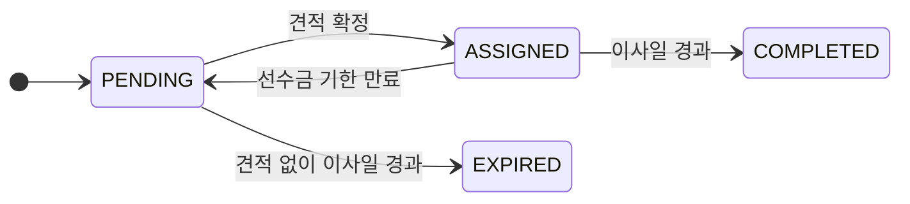
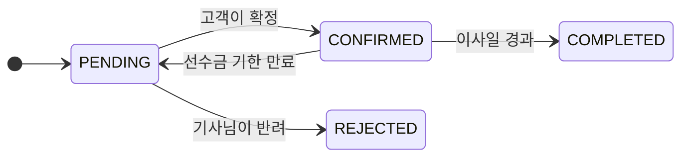
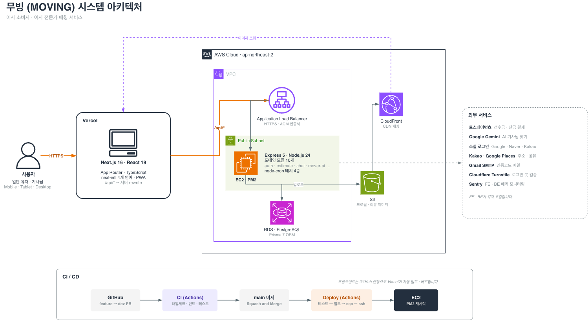

<div align="center">

<a href="docs/banner.png"></a>

# 무빙 (MOVING) · Backend

### 견적 요청부터 확정 · 결제까지, 이사 매칭의 규칙을 책임지는 API 서버

[**🌐 서비스 바로가기**](https://www.letsmoving.site) · [**🎬 시연 영상**](시연영상_링크) · [**🖥 Frontend 저장소**](https://github.com/3unbum/13-4-MOVING_FE)

코드잇 스프린트 13기 · 파트4 고급 프로젝트 · 4팀

</div>

<br />

## 📑 목차

1. [프로젝트 소개](#-프로젝트-소개)
2. [핵심 규칙 · 상태 흐름](#-핵심-규칙--상태-흐름)
3. [주요 기능](#-주요-기능)
4. [팀 소개 · 주요 링크](#-팀-소개--주요-링크)
5. [시스템 아키텍처](#-시스템-아키텍처)
6. [기술 스택 · 프로젝트 구조](#-기술-스택--프로젝트-구조)
7. [보안](#-보안)
8. [트러블 슈팅](#-트러블-슈팅)

<br />

## 💡 프로젝트 소개

**무빙**은 이사 소비자와 이사 전문가(기사님)를 이어 주는 견적 매칭 서비스입니다. 소비자가 이사 정보를 한 번 입력하면 기사님들이 견적을 보내고, 소비자는 견적가와 후기를 비교해 고른 뒤 결제와 후기 작성까지 한 서비스 안에서 마칩니다.

- **규칙은 서버가 지킵니다** — 활성 요청 1건, 견적 8건 상한, 상태 전이처럼 서비스의 규칙을 서버에서 검증하고, 동시에 요청이 들어와도 어긋나지 않도록 조건부 갱신과 재시도를 씁니다.
- **결제 값은 서버 기준으로 검증합니다** — 토스페이먼츠 승인 전에 금액 · 주문 · 상태를 서버가 다시 계산해 비교하고, 멱등 키와 조건부 갱신으로 이중 결제를 막습니다.
- **상태 정리는 배치가 맡습니다** — 이사일이 지난 요청 만료, 선수금 기한 만료 취소, 이사 전날 · 당일 알림, 기사님 경력 증가를 스케줄 작업으로 처리합니다.
- **실시간 알림은 커밋 이후에만 보냅니다** — SSE 알림을 트랜잭션이 커밋된 뒤에 전송해, 롤백된 알림이 화면에 뜨지 않습니다.
- **Prisma 스키마 21개 모델 · 10개 Enum**, **Jest 테스트 48개 파일**로 규칙과 경계 조건을 검증합니다.

<br />

## 🧭 핵심 규칙 · 상태 흐름

| 규칙 | 내용 |
| :-- | :-- |
| **활성 요청 1건** | 유저당 진행 중인 견적 요청은 하나만 가질 수 있습니다. (`PENDING` · `ASSIGNED`) |
| **견적 상한** | 한 요청당 최대 8건을 받습니다. (일반 5 + 지정 3) |
| **지역 매칭** | 기사님은 서비스 가능 지역 안의 요청만 조회합니다. |
| **프로필 게이트** | 프로필을 등록하기 전에는 전용 기능을 쓸 수 없습니다. |
| **선수금** | 확정한 견적의 10%를 확정 후 48시간 안에 결제해야 합니다. 이사일이 가까우면 이사일 0시(KST)가 기한이며, 넘기면 확정이 취소됩니다. |
| **추가 금액** | 기사님은 견적가의 20% 이내에서 추가 금액을 요청할 수 있고, 고객이 승인하면 잔금에 합산됩니다. |
| **채팅** | 이사일이 지나고 14일이 되면 새 메시지를 보낼 수 없고, 지난 대화는 볼 수 있습니다. |

**견적 요청 (QuotationRequest)**



**견적 (Estimate)**



**스케줄 작업**

| 작업 | 실행 시점 |
| :-- | :-- |
| 이사 전날 · 당일 알림 발송 | 매일 09:00 |
| 이사일이 지난 요청 정리 (확정 견적이 있으면 `COMPLETED`, 없으면 `EXPIRED`) | 매일 00:00 |
| 선수금 기한이 지난 확정 자동 취소 | 매 정각 |
| 기사님 경력 1년 증가 (60년 상한) | 매년 1월 1일 00:00 |

모두 `node-cron`으로 한국 시간 기준에 실행하며, 여러 번 실행해도 결과가 같도록 조건부 갱신으로 처리합니다.

<br />

## ✨ 주요 기능

<details>
<summary><b>기능과 구현 포인트 보기</b></summary>

| 기능 | 구현 포인트 |
| :-- | :-- |
| **인증 · 계정** | 일반 유저와 기사님을 역할로 나눠 가입 · 로그인하고, 구글 · 네이버 · 카카오 소셜 로그인을 지원합니다. 토큰은 `httpOnly` 쿠키로 발급 · 갱신합니다. 회원가입 · 비밀번호 재설정은 이메일 인증번호로 확인하며, 실패 횟수와 발송 횟수를 제한합니다. |
| **프로필** | 프로필 등록 전에는 전용 기능을 막는 게이트 미들웨어를 둡니다. 프로필 수정은 이메일 인증을 거쳐야 하고, 인증 후 30분 동안 계정 정보(이름 · 전화번호 · 비밀번호) 수정을 허용합니다. 이미지는 허용한 형식과 크기(5MB)만 받고, 파일 앞부분의 시그니처까지 검사한 뒤 S3에 저장합니다. |
| **견적 요청** | 유저당 활성 요청 1건을 지키고, 요청이 생기면 서비스 지역의 기사님에게 알림을 보냅니다. 일반 요청을 보낸 뒤에는 기사님을 직접 골라 지정 요청을 보낼 수 있습니다. |
| **견적 · 결제** | 기사님이 견적을 보내거나 반려하고, 고객이 확정합니다. 요청당 8건 상한은 동시 요청에도 지켜지도록 트랜잭션과 재시도로 검증합니다. 확정 후에는 선수금과 잔금을 토스페이먼츠로 결제하며, 승인 전에 서버가 금액 · 주문 · 상태를 다시 검증합니다. |
| **기사님 목록 · 찜** | 검색 · 필터 · 정렬(평점 · 리뷰 · 경력 · 확정 건수)을 지원하고 커서 기반 무한 스크롤로 내려줍니다. 정렬 값은 반정규화 컬럼으로 두고 `(정렬 키, id)` 복합 인덱스를 걸어, 정렬 키가 같아도 순서가 흔들리지 않습니다. |
| **리뷰** | 이사가 끝나고 잔금을 결제하면 후기를 쓸 수 있으며, 사진은 최대 3장입니다. 작성하거나 수정할 때 기사님의 평균 평점과 리뷰 수를 트랜잭션 안에서 다시 계산합니다. |
| **실시간 알림** | 13가지 알림 유형을 `text/event-stream`(SSE)으로 전달하고, 연결은 heartbeat로 유지합니다. 알림은 트랜잭션이 커밋된 뒤에만 전송하며, 채팅 알림은 방당 1건으로 합쳐 새 메시지가 오면 다시 읽지 않음으로 올립니다. |
| **채팅** | 견적을 확정하면 채팅방이 열리고, 방 목록과 메시지를 불러옵니다. 메시지는 분당 30건으로 제한합니다. |
| **AI 기사님 추천** | Gemini는 도착지 · 이사 유형 · 정렬 기준만 대화로 모으고, 기사님 목록은 서버가 DB에서 조회합니다. 모델이 기사님 정보를 지어내지 못하게 한 설계입니다. 모델이 느리거나 실패하면 재시도 후 보조 모델로 넘어가고, 전체 대기는 20초로 제한합니다. 조건을 바꾸겠다는 말은 Gemini 없이 서버에서 처리하며, 메시지는 분당 10건으로 제한합니다. |

</details>

<br />

## 👥 팀 소개 · 주요 링크

| 이름&emsp;&emsp; | 프론트엔드 | 백엔드 | GitHub |
| :-- | :-- | :-- | :-- |
| **이은범**<br />팀장 | · 공통 컴포넌트 Card-list(10종)<br />· 내 견적 관리 페이지(확정 견적 · 반려 견적 요청)<br />· 받은 요청 페이지(목록 · 견적 · 반려하기) | · Prisma 스키마 설계 · 마이그레이션<br />· 견적 요청 생성 · 조회 API<br />· 지정 견적 요청 API<br />· 이사일 경과 처리 배치<br />· 프로젝트 초기 구조 설계<br />· TypeScript 6 · Prisma 7 업그레이드 | [@3unbum](https://github.com/3unbum) |
| **송현규**<br />부팀장 | · 프론트엔드 초기 세팅(라우트 구조 · 라우팅 가드 · Provider · 디자인 토큰)<br />· 공통 컴포넌트(카드 배지 · 프로필 · 헤더 · 진행바, Chip)<br />· 견적 요청 페이지<br />· 랜딩 페이지<br />· 앱 로고 영문 변경<br />· 결제 플로우 UI<br />· 고객 · 기사 채팅방 UI | · 견적서 API(제시 · 확정 · 조회)<br />· 기사님 견적 관리 API(받은 요청 목록 · 반려)<br />· 견적 상한 검증(일반 5건 · 지정 3건)<br />· 고객 · 기사 채팅 API | [@singsangsong28](https://github.com/singsangsong28) |
| **김민수** | · AuthProvider · API 클라이언트 설정<br />· 공통 컴포넌트(Input, Button, ModalButton)<br />· 로그인 · 회원가입(소셜 로그인 포함)<br />· 아이디 · 비밀번호 찾기<br />· 회원 탈퇴<br />· 마이페이지 내 프로필(기사님) | · 회원가입 · 로그인 · 로그아웃(역할 분리)<br />· JWT 발급 · 갱신(쿠키), 비밀번호 해싱<br />· 인증 · 인가 미들웨어<br />· OAuth 소셜 로그인(구글 · 네이버 · 카카오)<br />· 내 계정 조회(GET /auth/me)<br />· 이메일 인증<br />· 아이디 찾기 · 비밀번호 재설정<br />· 로그인 시도 · 인증번호 발송 횟수 제한<br />· 회원 탈퇴 · 탈퇴 후 데이터 처리 | [@HoneyLatlll](https://github.com/HoneyLatlll) |
| **조서현** | · 공통 컴포넌트(Date picker, Pagination)<br />· 프로필 등록(일반 유저 · 기사님)<br />· 프로필 수정(일반 유저)<br />· 마이페이지 프로필 · 기본정보 수정(기사님)<br />· 프로필 수정 이메일 인증 게이트<br />· 프로필 이미지 변경 · 삭제, 소셜 계정 비밀번호 필드 숨김 | · 프로필 등록 API<br />· 프로필 조회 · 수정 API<br />· 프로필 이미지 업로드(multer-s3)<br />· 프로필 등록 게이트 미들웨어<br />· 프로필 수정 이메일 인증(30분 유지, 발송 횟수 제한)<br />· 계정 정보 수정 시 서버 측 인증 검증, 이미지 삭제 | [@sxohyuni](https://github.com/sxohyuni) |
| **문치호** | · 공통 컴포넌트(Modal / Pop-up, Tab)<br />· 찜한 기사님 페이지<br />· 작성 가능한 리뷰 · 내가 작성한 리뷰<br />· 마이페이지 기사님 리뷰 영역 | · 찜한 기사님 API(찜하기 · 해제 · 목록)<br />· 이사 리뷰 API(작성 가능 · 내 리뷰 · 기사님 리뷰)<br />· 평점 재계산 로직 | [@MunChiho](https://github.com/MunChiho) |
| **김은진** | · 공통 컴포넌트(Dropdown / Filter / Sort, GNB)<br />· 기사님 찾기(회원 / 비회원)<br />· 기사님 상세(회원 / 비회원)<br />· AI 챗봇 기사님 찾기(챗봇 모달 · 대화 상태 훅) | · 기사님 목록 API(검색 · 필터 · 정렬 · 무한 스크롤)<br />· 기사님 상세 조회 API<br />· 기사님 찜하기 API(찜하기 · 해제)<br />· 정렬 성능 개선(반정규화 컬럼 + 인덱스)<br />· 알림 API 초안<br />· AI 챗봇 기사님 추천 API(Gemini) | [@Eznnni](https://github.com/Eznnni) |

<details>
<summary><b>🤝 협업 방식</b></summary>

<br />

- `main` ← `dev` ← `{type}/{작업명}-{이슈번호}` 브랜치 전략을 쓰고, 직접 push 대신 PR로만 병합합니다. (`dev` 승인 2명 · `main` 승인 1명, Squash and Merge)
- 커밋은 `{type}: {내용}` 형식이며 husky + commitlint가 검사합니다. 이슈 템플릿 5종을 쓰고, PR에는 `close #번호`로 이슈를 연결합니다.
- PR을 열면 GitHub Actions가 타입 체크 · 린트 · 테스트를 돌리고, 팀원 리뷰와 함께 AI 코드 리뷰(CodeRabbit)를 받습니다.

</details>

### 주요 링크

- 📒 [팀 Notion](https://app.notion.com/p/bum0107/4f62c0a94b6182509d1281654aab75d0)
- 📋 [요구사항 분석 · Task List](https://app.notion.com/p/bum0107/3cd2c0a94b61800b8a1cf0912131c2f0)
- 📘 [API 명세](https://app.notion.com/p/bum0107/API-f542c0a94b618394b54e81bc11e29240) · Swagger `/api-docs` (개발 환경)
- 🖥 [Frontend 저장소](https://github.com/3unbum/13-4-MOVING_FE)

<br />

## 🏗 시스템 아키텍처

<a href="docs/architecture.png"></a>

<br />

## 🧰 기술 스택 · 프로젝트 구조

### Language


### Framework & Libraries


### Hosting & Deployment


### Storage & Database


### CI/CD · Version Control


### External Services


<details>
<summary><b>📁 프로젝트 구조</b></summary>

<br />

```text
src/
├── app.ts · server.ts         # Express 앱 구성 · 서버 시작 (instrument.ts는 Sentry)
├── config/                    # env · prisma · s3 · mailer · sentry · swagger
├── common/
│   ├── middlewares/           # auth · role · profile · rateLimit · turnstile · validate · errorHandler
│   ├── errors/                # AppError · 에러 코드
│   ├── utils/                 # jwt · hash · cookie · 파일 시그니처 검사
│   └── types/
├── modules/                   # 기능 단위로 나누고, 안에서 route → controller → service → repository
│   ├── auth/                  #   인증 (oauth · mail · password-reset 포함)
│   ├── profile/ · mover/ · mover-ai/
│   ├── quotation-request/ · estimate/     # 견적 요청 · 견적 · 토스 결제
│   ├── review/ · favorite/
│   └── notification/ · chat/
├── routes/index.ts            # 모듈 라우터 조립
└── jobs/                      # 스케줄 작업 (cron)
prisma/                        # schema.prisma · migrations · seed.ts
tests/                         # 테스트 공용 설정 · 헬퍼
```

</details>

<br />

## 🔒 보안

<details>
<summary><b>보안 적용 내용 보기</b></summary>

| 항목 | 적용한 방식 |
| :-- | :-- |
| **비밀번호** | bcrypt로 해싱해서 저장합니다. |
| **토큰** | 액세스 · 리프레시 토큰을 `httpOnly` 쿠키로 보내고, `SameSite=Lax`를 적용하며 운영 환경에서는 `Secure`를 켭니다. 소셜 가입 중간 토큰과 비밀번호 재설정 토큰은 별도 시크릿과 만료 시간을 씁니다. |
| **요청 제한** | `express-rate-limit`으로 로그인(15분 5회), 인증번호 발송 · 확인, AI 메시지(분당 10건), 채팅 메시지(분당 30건)를 제한합니다. |
| **입력 검증** | 라우트마다 Zod 스키마로 요청을 검증하는 `validate` 미들웨어를 거칩니다. |
| **봇 방지** | 로그인과 회원가입 인증번호 발송 단계에서 Cloudflare Turnstile 토큰을 서버에서 검증하며, 요청 제한보다 먼저 확인합니다. |
| **CORS** | 허용한 프론트엔드 주소 목록만 받고, 쿠키를 쓰기 때문에 와일드카드는 쓰지 않습니다. |
| **SQL 인젝션** | Prisma Client로 접근하고, 원시 쿼리가 필요한 곳은 값이 바인딩되는 태그드 템플릿(`$queryRaw`)만 씁니다. |
| **업로드 검사** | 허용한 이미지 형식과 5MB 제한에 더해, 파일 앞부분의 시그니처로 실제 형식을 확인합니다. |
| **결제 검증** | 토스 승인 전에 금액 · 주문 · 소유자 · 상태를 서버 기준으로 다시 검증합니다. |
| **오류 노출** | 운영 환경에서는 오류의 상세 내용과 스택을 응답에 싣지 않습니다. |
| **비밀 값 분리** | 키는 `.env`와 GitHub Secrets로 분리하고, CI의 테스트는 더미 값만 씁니다. |

</details>

<br />

## 🔍 트러블 슈팅

<details>
<summary><b>[CI/CD] EC2 빌드 중 OOM 문제와 러너 빌드 전환</b></summary>

<br />

> 이은범 · BE · 관련 PR [#107](https://github.com/3unbum/13-4-MOVING_BE/pull/107)

**문제 상황** —

- **기존 방식**: EC2에 SSH로 접속해 `git reset --hard` → `npm ci` → `prisma generate` → `npm run build`를 순서대로 실행했습니다.
- **발생 문제**: 서버가 떠 있는 바로 그 머신에서 빌드했습니다. t2.micro(메모리 1GB)인데 `tsc` 전체 컴파일과 `prisma generate`가 메모리를 크게 사용했습니다.
- **영향 범위**: 빌드 중 PM2로 떠 있는 운영 서버까지 함께 느려졌습니다. CI/CD 특강에서 "EC2에서 빌드하면 OOM으로 죽는다"는 지적을 받았습니다.

**원인 분석** — **빌드와 실행을 같은 머신에서 수행하는 구조**였습니다.

- 러너는 코드 검증만 하고 종료합니다.
- EC2가 소스를 받아 의존성 설치, Prisma 생성, 타입 컴파일을 전부 수행합니다.
- 운영 서버 사양이 **실행이 아니라 빌드 기준**에 묶입니다.

두 작업의 요구 사항이 정반대입니다.

| | 빌드 | 실행 |
| :-- | :-- | :-- |
| 필요 자원 | CPU · 메모리 많이 | 적게 |
| 필요 의존성 | devDependencies 전부 | 런타임만 |
| 빈도 | 배포할 때 한 번 | 상시 |

**실패 지점이 배포 후반이라는 점이 더 문제였습니다.**

- 러너 단계를 전부 통과합니다.
- EC2에서 `git reset --hard origin/main`이 이미 실행되어 소스가 새 커밋으로 교체됩니다.
- 그 다음 `npm run build`에서 실패하면 소스는 새 커밋, 서버는 옛 `dist`로 동작하는 불일치 상태가 됩니다.

**해결** — **빌드를 러너로 옮기고 EC2에는 결과물만 전송했습니다.**

1. **러너에서 빌드 후 산출물 압축 전송**
   - GitHub Actions 러너는 2코어 7GB를 무료로 제공하며, 배포할 때만 사용합니다.
   - `dist`(빌드 결과) · `generated`(Prisma Client) · `prisma`(스키마 · 마이그레이션) · `package*.json`을 압축해 `scp`로 전송합니다.
   - `generated/`는 gitignore 대상이라 EC2에서 `git pull`로 받을 수 없고, 거기서 만들면 또 CPU를 사용하므로 러너에서 만들어 함께 전송했습니다.
2. **EC2는 런타임 의존성만 설치하고 실행**
   - `npm ci --omit=dev`로 `typescript` · `jest` · `prisma` CLI를 운영 서버에서 제거했습니다.

```yaml
# Before — EC2에서 전부 수행
- name: SSH로 EC2 접속해 배포
  script: |
    git fetch origin main
    git reset --hard origin/main
    npm ci
    npx prisma generate # 메모리 사용
    npm run build # 메모리 사용 — 여기서 OOM

# After — 러너에서 빌드, EC2는 실행만
- name: 빌드
  run: npm run build

- name: 배포 파일 압축
  run: tar -czf deploy.tar.gz dist generated prisma package.json package-lock.json

- name: EC2로 전송
  uses: appleboy/scp-action@v1

- name: SSH로 EC2 접속해 실행
  script: |
    tar -xzf deploy.tar.gz
    npm ci --omit=dev --ignore-scripts # 런타임 의존성만
    pm2 reload moving-backend --update-env \
      || pm2 start dist/src/server.js --name moving-backend
```

3. **전환 과정에서 걸린 두 가지**
   - `npm ci --omit=dev`가 **husky를 찾지 못해 실패**했습니다. `package.json`의 `prepare` 스크립트가 husky를 호출하는데 husky는 devDependency라서, `--ignore-scripts`를 추가했습니다.
   - 테스트 단계가 **`.env` 없이 실패**했습니다. `config/env.ts`가 모듈 로드 시점에 필수 환경변수를 검증해서, 전부 모킹인 단위 테스트도 import 단계에서 터졌습니다. 더미 `.env` 생성 단계를 추가했습니다.

**개선 효과** —

- **OOM 가능성 제거** — EC2에서 빌드가 사라져, 배포 중 서버 응답이 느려지던 현상도 함께 해소되었습니다.
- **실패해도 운영 서버가 안전** — 빌드가 실패하면 러너에서 멈추므로 EC2는 건드려지지 않습니다. 소스만 교체되고 빌드는 실패한 불일치 상태가 **구조적으로 발생하지 않습니다**.
- **운영 서버 경량화** — `typescript` · `jest` · `prisma` CLI 등 devDependencies가 EC2에서 제거되었습니다.

**배운 점** —

- **빌드와 실행을 분리해야 서버 사양을 실행 기준으로 산정할 수 있습니다.** "EC2에 소스가 있으니 거기서 빌드하는 게 자연스럽다"는 판단 하나로 서버 사양이 빌드 기준에 묶였습니다.
- **파이프라인은 실패 지점까지 설계해야 합니다.** 같은 "빌드 실패"라도 러너에서 발생하면 영향이 없지만, EC2에서 발생하면 서버가 불일치 상태가 됩니다. 성공 경로만이 아니라 **실패했을 때 어디까지 망가지는지**를 기준으로 순서를 정해야 합니다.
- **무료로 주어지는 자원을 먼저 확인해야 합니다.** 러너 2코어 7GB를 두고 1GB EC2에서 빌드하고 있었습니다.

</details>

<br />

<details>
<summary><b>[결제] 결제 승인에서 클라이언트 값을 믿지 않기: 금액 위변조 · 이중 결제 방어와 가짜 결제 통과 사고</b></summary>

<br />

> 송현규 · BE (FE 연동 포함) · 관련 PR BE [#145](https://github.com/3unbum/13-4-MOVING_BE/pull/145), FE [#220](https://github.com/3unbum/13-4-MOVING_FE/pull/220)

**문제 상황** — 토스페이먼츠 결제를 붙였습니다. 결제가 성공하면 토스가 `successUrl`로 `paymentKey`, `orderId`, `amount`를 쿼리로 붙여 리다이렉트하고, FE는 이 값을 `POST /estimates/:id/pay`로 BE에 넘겨 승인합니다. 이 값은 사용자가 주소창에서 바꿀 수 있어서 그대로 믿으면 세 가지 문제가 생깁니다.

1. 견적가보다 작은 `amount`로 승인 요청을 보내는 금액 위변조
2. 남의 `estimateId`로 요청하는 타인 견적 결제
3. 같은 견적에 동시 요청이 들어올 때의 이중 결제

실제로 로컬 테스트 중에는 가짜 `paymentKey`로 성공 URL을 열었을 뿐인데 견적 676이 `PAID`로 바뀌는 사고가 있었습니다.

**원인 분석** —

- 위변조와 이중 결제는 구조적 위험이었습니다. 승인 요청의 입력이 전부 클라이언트에서 오고, 검증과 상태 갱신 사이에 다른 요청이 끼어들 수 있었습니다.
- 가짜 결제 통과 사고는 BE가 `TOSS_SECRET_KEY` 없이 떠 있었던 것이 원인이었습니다. BE 개발 서버가 `.env`를 수정하기 전에 떠 있어 키를 읽지 못했고, 로컬 · CI 편의를 위해 만들어 둔 "키가 없으면 토스 호출 생략" 분기가 동작했습니다. 이 모드에서는 서버가 클라이언트 값을 그대로 믿으므로, 개발 편의용 분기가 검증 우회 경로가 되었습니다.

**해결** —

1. **승인 전 서버 기준 검증**: 본인 견적인지(403), 결제 가능한 상태인지, 이미 결제했는지, 추가 금액 요청에 응답했는지를 확인합니다. 기준 금액은 서버가 직접 계산하고, 클라이언트의 `amount`와 `orderId`(`moving-{type}-{estimateId}`)는 비교만 합니다. 틀리면 토스 호출 전에 거절해서 청구가 일어나지 않습니다.
2. **승인 요청 설계**: `Idempotency-Key`에 `orderId`를 넣어 재전송 시 중복 승인을 막고, 토스에는 `paymentKey` / `orderId` / `amount` 셋만 보냅니다. 10초 타임아웃을 걸고, 응답을 못 받은 경우는 승인 여부를 알 수 없으므로 일반 실패로 처리합니다.
3. **조건부 갱신**: 승인 직후 `updateMany`에 `COMPLETED + UNPAID` 조건을 걸고, 갱신된 행이 1이 아니면 409로 처리합니다. 결제 완료 알림 생성도 같은 트랜잭션에 묶었습니다.
4. **사고 대응**: 테스트 데이터는 `WHERE id = 676 AND payment_key = 'dummy_payment_key'`로 조건을 좁혀 `UNPAID`로 복구했습니다. 서버 재시작 후 가짜 `paymentKey`가 토스에서 `NOT_FOUND_PAYMENT_SESSION`으로 거절되는 것을 확인했습니다(`INVALID_API_KEY`가 아니라 세션 없음이므로 키 인증은 통과한 상태입니다). 키가 없을 때 가짜 결제가 통과할 수 있다는 위험은 작업 기록에 남기고, 배포 시 필수 변수로 점검할 것을 제안했습니다.
5. **알려진 한계를 코드에 명시**: 토스 승인 성공 후 DB 갱신이 실패하면 돈만 빠진 상태가 되는데, 웹훅 보정은 범위 밖으로 두고 `ponytail:` 주석으로 남겼습니다. 대신 `estimateId`, 결제 종류, `paymentKey`를 로그로 남겨 추적할 수 있게 했습니다.

```typescript
// Before: 클라이언트가 보낸 값을 그대로 승인에 넘긴다고 가정한 구조 (설계 전 위험)
await confirmTossPayment(input); // amount/orderId를 믿는다
await estimateRepository.pay(estimateId); // 조건 없이 PAID로 갱신

// After: 서버 기준으로 비교 → 승인 → 조건부 갱신
if (
  input.amount !== expectedAmount ||
  input.orderId !== toPaymentOrderId(estimateId, input.type)
) {
  throw AppError.badRequest(ERROR_CODES.PAYMENT_FAILED, "결제 금액 또는 주문 정보가 견적과 일치하지 않습니다");
}

await confirmTossPayment(input); // Idempotency-Key: orderId

const paid = await estimateRepository.pay(estimateId, input.paymentKey); // COMPLETED+UNPAID 조건부
if (!paid) throw AppError.conflict(ERROR_CODES.ALREADY_PAID, "이미 결제한 견적입니다");
```

**개선 효과** —

- 금액 · 주문 정보 위변조, 타인 견적 결제, 동시 요청에 의한 이중 결제가 서버에서 차단됩니다. 검증은 단위 테스트(토스 호출은 목)와 `tsc`, `eslint`로 확인했습니다.
- 실제 토스 호출은 더미 `paymentKey`로 확인해, 키 인증이 통과하고 세션 없음으로 거절되는 것까지 검증했습니다.
- 사고를 계기로 개발 편의 분기가 보안 구멍이 될 수 있다는 점을 배포 전에 위험으로 기록했습니다.
- 한계: 승인 후 DB 실패 보정과 실제 토스 테스트 결제의 성공 경로(`PAID` → 결제 내역 화면)는 검증하지 못했습니다.

**배운 점** —

- 결제에서 클라이언트가 보내는 금액과 주문 정보는 참고값일 뿐입니다. 기준은 서버가 계산하고, 승인보다 앞에서 비교해야 합니다.
- 되돌리기 어려운 외부 승인은 "검증 → 승인 → 조건부 갱신" 순서와 멱등 키를 함께 설계해야 합니다.
- 키가 없을 때 건너뛰는 편의 모드는 운영에서 보안 우회 경로가 됩니다. 건너뛰기를 환경(로컬 · CI)에 한정하거나, 운영에서는 시작 시점에 실패시키는 방식이 더 안전합니다.

</details>

<br />

<details>
<summary><b>[보안] OAuth `state` — role 전달용에서 CSRF 방어용으로</b></summary>

<br />

> 김민수 · FE · 관련 PR [#116](https://github.com/3unbum/13-4-MOVING_FE/pull/116)

**문제 상황** — 소셜 로그인은 외부 사이트를 거쳐 공용 콜백 주소(`/oauth/[provider]/callback`)로 돌아오기 때문에, 출발한 로그인 페이지의 role을 알기 위해 `state` 파라미터에 role을 실어 보내고 콜백에서 그대로 읽어 썼습니다(`?code=...&state=CUSTOMER`). 이 구조에서는 공격자가 자기 계정으로 받은 `code`를 담은 콜백 링크를 피해자에게 클릭시키면 **피해자의 브라우저가 공격자 계정으로 로그인**됩니다(Login CSRF). 피해자가 입력한 이사 주소 · 연락처는 공격자 계정에 쌓여, 공격자가 나중에 그대로 열람할 수 있습니다.

**원인 분석** — 공격자가 보내는 `code`와 `state`는 모두 정상 발급된 값이라 형식 검증으로는 걸러낼 수 없었습니다. 아직 로그인 전이라 인증 미들웨어도 개입할 수 없습니다. "요청 내용이 올바른가"가 아니라 **"이 브라우저가 시작한 로그인인가"** 를 확인할 수단이 없는 것이 문제였습니다.

**해결** — `state`에 role 대신 1회용 랜덤 nonce를 싣고, 같은 nonce를 role과 함께 `sessionStorage`에 저장했습니다. 콜백에서는 URL의 `state`와 저장값을 대조해 일치할 때만 진행하고, role은 URL이 아니라 저장값에서 복원합니다. 공격자가 만든 링크에는 피해자 브라우저에 짝이 되는 nonce가 없어서 대조 단계에서 막힙니다.

```typescript
// Before — URL의 state를 그대로 role로 신뢰
<OAuthCallbackClient provider={provider} code={code} role={state} />

// After
export function createOAuthState(role: UserRole): string {
  const nonce = crypto.randomUUID();
  sessionStorage.setItem(OAUTH_STATE_KEY, JSON.stringify({ nonce, role }));
  return nonce;
}

export function consumeOAuthState(state: string): UserRole | null {
  const saved = sessionStorage.getItem(OAUTH_STATE_KEY);
  sessionStorage.removeItem(OAUTH_STATE_KEY); // 1회용 — 대조 결과와 무관하게 삭제
  if (!saved) return null;
  const { nonce, role } = JSON.parse(saved) as { nonce: string; role: UserRole };
  return nonce === state ? role : null;
}
```

**개선 효과** — 다른 브라우저에서 시작된 인가 요청의 콜백은 "잘못된 접근" 처리되어 로그인 CSRF가 차단되었습니다. 콜백 URL에 role이 노출되지 않게 되었고, 백엔드 변경 없이 프론트만으로 해결했습니다.

**배운 점** — 형식 검증("요청 내용이 맞는가")과 출처 검증("이 브라우저가 시작한 요청인가")은 다른 문제라는 것을 배웠습니다. OAuth의 `state`는 값을 실어 나르는 칸이 아니라 출처를 확인하기 위한 장치라는 점도 알게 되었습니다.

</details>

<br />

<details>
<summary><b>[입력 검증] 숫자 입력칸에서 `1e5`가 검증을 통과해 DB에 저장된 문제</b></summary>

<br />

> 조서현 · FE · 관련 PR [#109](https://github.com/3unbum/13-4-MOVING_FE/pull/109)

**문제 상황** — 기사님 프로필 등록의 경력 입력칸에 `1e5`를 넣고 제출하면 `career = 100000`이 실제 DB에 저장됐습니다. 팀원 코드 리뷰에서 DB 조회로 확인한 사례였고, 같은 칸에 `1년`처럼 문자가 섞이면 값을 입력했는데도 "경력을 입력해주세요"라는 엉뚱한 에러가 떴습니다.

**원인 분석** — 경력 칸은 `type="text"` + `inputMode="numeric"`이었습니다. `inputMode`는 모바일 키패드를 숫자로 바꿔 달라는 **힌트**일 뿐 입력을 막지 않아서, 물리 키보드나 붙여넣기로는 어떤 문자든 들어갑니다. 게다가 `Number("1e5")`는 `100000`으로 변환되기 때문에 `int().min(0)` 검증을 그대로 통과했습니다. 앞서 CodeRabbit이 짚은 "빈 값을 `0`으로 바꿔 필수 검증을 무력화하는" `setValueAs`도 같은 뿌리였습니다. 값이 어떻게 변환되는지 확인하지 않은 채 검증을 제출 시점에만 둔 것이 문제였습니다.

**해결** — 제출 시점 검증을 강화하는 대신 **입력 단계에서 막는 쪽**을 골랐습니다.

```tsx
<InputTextField
  type="text"
  inputMode="numeric"
  onInput={(e) => {
    e.currentTarget.value = e.currentTarget.value.replace(/\D/g, "");
  }}
  {...register("career", {
    // 빈 값은 0이 아니라 undefined로 두어 스키마가 필수 오류를 내게 한다
    setValueAs: (v) => {
      if (v == null || (typeof v === "string" && v.trim() === "")) return undefined;
      const n = Number(v);
      return Number.isNaN(n) ? undefined : n;
    },
  })}
/>
```

이후 비정상적으로 큰 값(`50000`)이 저장되는 문제가 리뷰에서 다시 나와, FE 스키마(`moverProfileSchema.career`)와 BE 스키마에 `.max(60)` 상한을 같이 두고, 매년 1월 1일 경력을 +1 하는 배치(`moverCareerIncrement`)도 60년에서 멈추게 맞췄습니다.

**개선 효과** — `1e5` · `1년` 같은 값이 입력 단계에서 숫자만 남아 의도하지 않은 값이 저장되지 않고, 빈 입력은 "필수" 오류로 정확히 안내됩니다. FE · BE 양쪽에 같은 상한을 두어 한쪽을 우회해도 막힙니다.

**배운 점** — `inputMode`는 검증이 아니라 힌트입니다. `Number()` 변환이 `1e5`나 `0x1F`까지 받아들인다는 점을 알고, 숫자 전용 입력은 입력 단계 필터링 + 스키마 상한을 기본으로 깔아야 합니다.

</details>

<br />

<details>
<summary><b>[알림] GNB 알림 패널 재설계와 지정 견적 반려 알림</b></summary>

<br />

> 문치호 · FE · 관련 PR FE [#171](https://github.com/3unbum/13-4-MOVING_FE/pull/171), [#192](https://github.com/3unbum/13-4-MOVING_FE/pull/192), [#244](https://github.com/3unbum/13-4-MOVING_FE/pull/244) / BE(알림 모듈) [#100](https://github.com/3unbum/13-4-MOVING_BE/pull/100), [#115](https://github.com/3unbum/13-4-MOVING_BE/pull/115), [#150](https://github.com/3unbum/13-4-MOVING_BE/pull/150)

**문제 상황** — 피그마 알림은 문장과 시간만 있는 목록이었습니다. 읽음, 삭제, 빈 목록, 기사님의 오늘 새 요청은 디자인이 없어 전달받은 시안으로 패널을 먼저 만들었습니다. 그 시안은 전체 읽음 · 전체 삭제가 하단의 큰 카드였고, 카드 오른쪽 `>`가 읽음 · 삭제 메뉴를 열었습니다. 안 읽은 카드는 빨간 배경이었고, `읽지 않음 N`은 개수만 보여 줬습니다. 지정 견적을 반려해도 알림이 가지 않아, 고객은 견적 목록을 직접 열어야 알 수 있었습니다.

**원인 분석** — 시안이 일괄 동작을 목록 아래 액션 카드로 두어, 알림이 적어도 목록 자리가 좁았습니다. `>`는 상세로 이동하는 표시라 메뉴가 열린다는 것을 알기 어려웠습니다. 읽지 않음은 색과 숫자만 있고 그 항목만 보는 동작이 없었습니다. 반려는 견적 상태로만 남아 있고 알림 타입에는 없었습니다.

**해결** — 종류별 아이콘, 읽음 상태, 빈 목록, 오늘 새 요청은 유지하고 조작 위치만 바꿨습니다. 전체 읽음 · 전체 삭제는 닫기 옆 글자 칩으로 올리고, 누르면 확인 후 실행합니다. 카드의 `>`는 케밥으로 바꿔 읽음 · 삭제를 열고, 카드 본문을 누르면 해당 화면으로 이동합니다. `읽지 않음 N` 칩을 누르면 안 읽은 항목만 남고, 모두 읽으면 칩은 숨깁니다. 안 읽은 카드 배경은 `orange-100`으로 맞췄습니다. 알림이 4개부터 패널 안에서 스크롤됩니다. 지정 견적 반려는 `ESTIMATE_REJECTED`로 추가하고, 문장은 프론트가 기사님 닉네임으로 조립합니다. 누르면 견적 상세로 이동하고, 반려 사유는 상세에서 봅니다. 동시에 반려되어도 알림은 한 번만 만들어집니다.

```typescript
// Before — 하단 액션 카드, > 메뉴, 안 읽음은 표시만
<div className={unread ? "bg-red-100" : "bg-background-100"}>
  <button onClick={onClick}>{message}</button>
  <Image src={chevronRight} alt="" />
</div>
<footer>
  <FooterAction label="전체 읽음" onClick={onReadAll} />
  <FooterAction label="전체 삭제" onClick={onDeleteAll} />
</footer>

// After — 헤더 칩, 케밥 메뉴, 안 읽음 칩이 필터
<div className={unread ? "bg-orange-100" : "bg-background-100"}>
  <button onClick={onClick}>{message}</button>
  <button aria-label="더보기" onClick={openMenu}>
    <KebabIcon />
  </button>
</div>
<header>
  {unreadCount > 0 && (
    <button aria-pressed={unreadOnly} onClick={() => onUnreadOnlyChange(!unreadOnly)}>
      읽지 않음 {unreadCount}
    </button>
  )}
  <button onClick={() => confirm("read")}>전체 읽음</button>
  <button onClick={() => confirm("delete")}>전체 삭제</button>
</header>
```

**개선 효과** — 일괄 동작이 헤더로 올라가 목록이 패널의 본문이 되었습니다. 이동과 항목 메뉴가 나뉘어 누르기 전에 결과를 알 수 있습니다. 안 읽은 알림만 바로 걸러 볼 수 있고, 지정 견적 반려도 목록을 열기 전에 알림으로 전달됩니다.

**배운 점** — 피그마가 없는 화면은 시안을 붙인 뒤, 알림이 쌓인 높이에서 다시 봐야 합니다. 아이콘은 동작을 알려 주므로 이동과 메뉴를 같은 기호에 두면 안 됩니다. 안 읽음은 색만으로 끝나지 않고, 개수 칩이 필터가 되어야 하며 읽을 항목이 없으면 필터도 같이 사라져야 합니다.

</details>

<br />

<details>
<summary><b>[알림] 커밋 전에 알림 SSE가 나가는 문제</b></summary>

<br />

> 김은진 · BE · 관련 PR [#99](https://github.com/3unbum/13-4-MOVING_BE/pull/99)(closed), [#100](https://github.com/3unbum/13-4-MOVING_BE/pull/100)

**문제 상황** — 견적 요청, 견적 확정, 이사 당일 배치처럼 알림은 **DB 트랜잭션 안에서 만들어집니다.** `createNotification`은 INSERT 직후 `setImmediate`로 그 유저의 SSE 연결에 바로 푸시했습니다. 트랜잭션이 커밋되기 전이라, 클라이언트는 알림을 받았는데 목록을 다시 조회하면 그 알림이 없는 상태가 생길 수 있었습니다. 뒤에 있는 INSERT가 실패해 롤백되거나, 같은 트랜잭션이 재시도되면 더 어긋납니다. DB에는 행이 없는데 화면에는 이미 떠 있고, 재시도가 성공하면 같은 알림이 한 번 더 나갑니다.

**원인 분석** — `setImmediate`는 콜백을 이벤트 루프에 넘길 뿐, 커밋을 기다리지 않습니다. 트랜잭션 콜백이 끝난 시점과 커밋 성공은 다르고, 롤백되어도 이미 예약된 푸시는 취소되지 않습니다. 목록은 커밋된 행만 돌려주므로 새로고침하면 맞아 보이지만, SSE를 받은 화면은 그 전에 이미 뱃지와 토스트를 띄운 뒤입니다. 실시간 연결과 조회 API가 서로 다른 시점을 보고 있었습니다.

**해결** — INSERT 시점에는 `AsyncLocalStorage` 대기열에만 넣고, `$transaction`을 `runAfterCommitPublish`로 감쌌습니다. 함수가 성공한 뒤에만 `publish`하고, 예외가 나면 대기열을 버린 채 끝납니다.

```typescript
// Before
const item = toNotificationItem(created);
setImmediate(() => publishNotification(created.userId, item));

await prisma.$transaction(async (tx) => {
  await createNotification(tx, params);
});

// After
enqueueNotificationPublish(created.userId, toNotificationItem(created));

await runAfterCommitPublish(() =>
  prisma.$transaction(async (tx) => {
    await createNotification(tx, params);
  })
);
```

**개선 효과** — SSE는 커밋된 알림만 전달합니다. 트랜잭션 중간에 실패하면 클라이언트는 그 알림을 받지 않고, 새로고침한 목록과도 어긋나지 않습니다. 재시도가 성공했을 때 롤백된 시도의 알림이 먼저 가 있던 문제도 없습니다. 견적 요청처럼 수신자가 여러 명이어도, 전원에 대한 푸시가 그 트랜잭션의 커밋 뒤로 모입니다.

**배운 점** — 실시간으로 전달되는 알림 데이터와 실제 진입 시 호출되는 목록 API는 반드시 같은 커밋 결과를 바라봐야 합니다. 백엔드의 트랜잭션 설계가 잘못되면 프론트엔드에서는 '거짓 알림(Ghost Notification)'이라는 최악의 UX 버그로 이어질 수 있어, 트랜잭션을 설계할 때 신중해야 함을 깨달았습니다.

</details>
